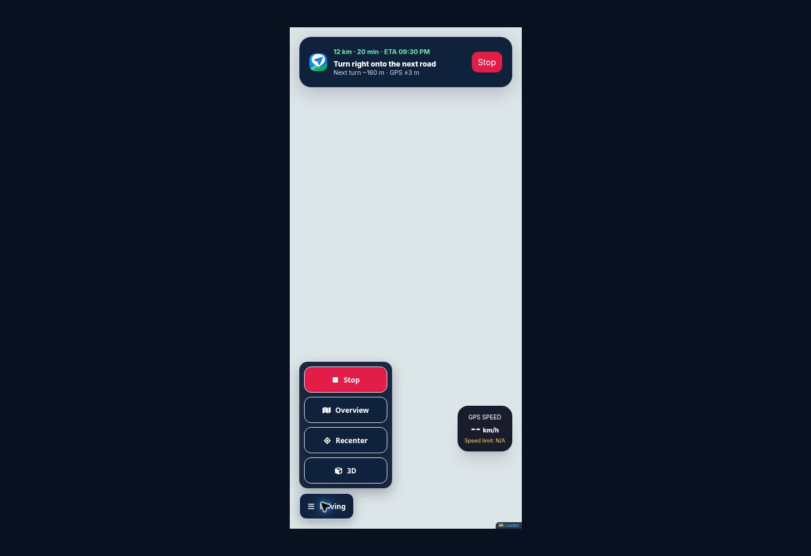

# Driving controls overlap fix

The premium shell moved `liveNavHUD` to the top, but the older `jg65Dock` still used its top-left position. The Driving/Pandu toggle therefore covered the ETA and turn instructions.

The driving dock now anchors at the bottom left, above the bottom safe area. Its controls expand upward. The maximum menu height uses the measured bottom edge of the instruction HUD and the current viewport height; ResizeObserver and resize events keep it current when text wraps or screen dimensions change. A short viewport scrolls the menu instead of letting it cover the instructions.

Validation: `node --test tests/audit.test.cjs` — 32 passing tests; `git diff --check` passes. Browser layout fixtures checked collapsed/expanded controls at 320×568, 390×844 and 640×360. At 320px the HUD ended at y=135 and the expanded menu began at y=287. In landscape the HUD ended at y=101 and the menu began at y=125; the menu's 213px content scrolled within 167px. Fixtures used generic instructions and omitted network tiles/GPS; this validates layout, not live navigation.

