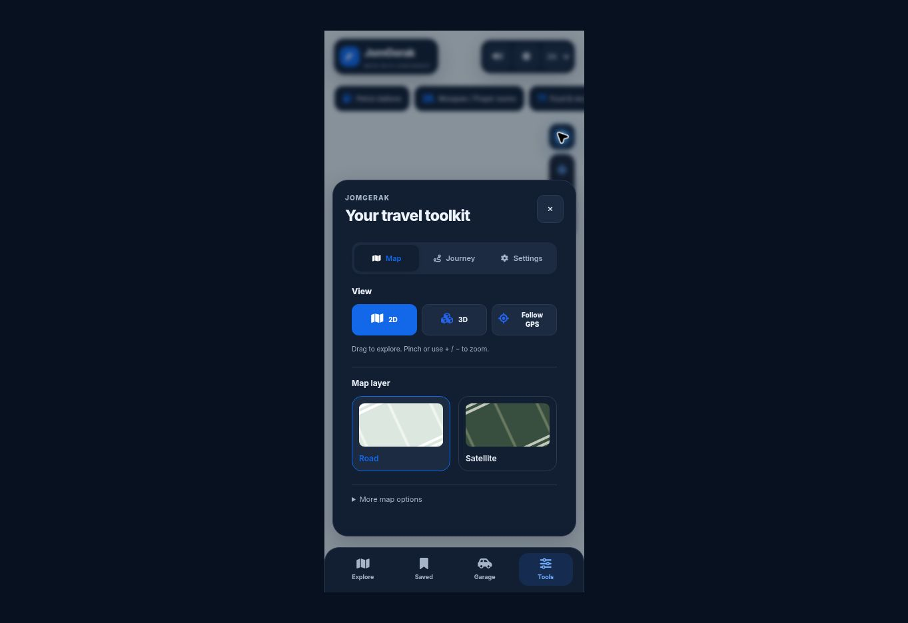
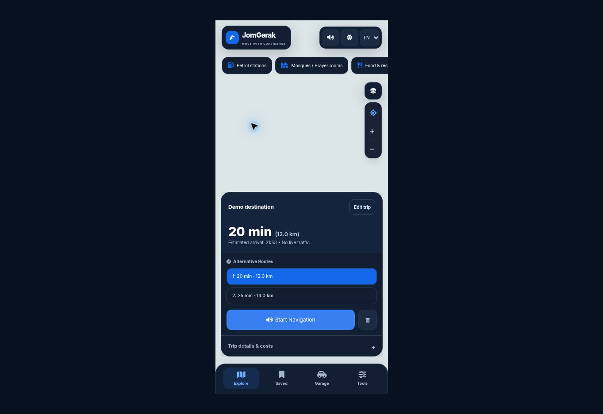

# Interactive 3D, simpler map controls and route sheet

The supplied JomGerak and Pintaz recordings were reviewed locally. This change repairs confirmed interaction defects and follows the reference's compact map → route choices → navigation progression with JomGerak's own design. It does not replicate Pintaz's private backend, map files, 3D vehicle assets or complete native feature set.

## Repaired interaction defects

- `v671.js` set `pointer-events:none` inline on the initially hidden 3D element. Opening 3D never reversed it. CSS now owns visibility/hit testing: hidden 3D ignores input and shown 3D explicitly accepts touch. Activation also clears stale inline state.
- GPS updates called two camera controllers. The duplicate camera movement is removed; the remaining controller respects manual follow suspension and preserves zoom/pitch. Touch/pointer interaction pauses GPS following until Recenter/Follow GPS is requested.
- Zoom controls now target the active renderer instead of zooming the hidden Leaflet map while MapLibre is visible. My Location also centers the active 3D map. MapLibre pan/pinch/scroll interaction is enabled explicitly.
- Returning to 2D preserves the explored 3D center and zoom. Failed 3D activation restores the 2D state and removes a partial failed canvas.

## Interface changes

- Tools → Map has one View selector (2D / 3D / Follow GPS) and two actual layers (Road / Satellite). Navigator, Standard, Smart, Night and provider-specific duplicates are removed from this menu. Existing provider configuration and underlying handlers remain available for compatibility.
- A Layers button opens that same panel; no second map-settings surface is created.
- 3D building extrusions are optional and off by default to reduce visual blocks. More map options → 3D buildings enables compatible vector data. This is separate from perspective/gesture controls.
- Install moves into Tools → Settings → App & support. It cannot float above the map, even before bootstrap, and the native install prompt runs only after an explicit action.
- A calculated route shows a single compact sheet with destination, ETA/distance, actual alternatives and a full-width Start Navigation action. Trip details & costs retains the existing fuel/toll controls and full instructions behind a disclosure. Edit trip restores endpoint inputs; clearing a route restores normal search. English route ETA uses an English time format.
- Required transport mounts remain present, so car, motorcycle, truck, 4×4, walking, rail, voice and prayer modules continue to render.

## Pintaz technology: confirmed public information

According to [Pintaz's official privacy policy](https://pintazapp.com/privacy-policy.html), section 4:

| Component | Disclosed use |
| --- | --- |
| MapLibre | Map rendering library |
| OpenStreetMap / Photon | Place search and POI data |
| Cloudflare | Hosting map tiles, satellite imagery and voice clips |
| TomTom | Live traffic and incident data |

This does not identify every internal routing algorithm or the underlying satellite imagery license/source. It is not evidence that one public API reproduces the entire app. JomGerak already uses MapLibre for its perspective renderer; its existing MapTiler/OSM configuration remains its own. Lane-level geometry, traffic-aware route calculation, native integrations and private map infrastructure are separate development work, not implemented by copying the visible UI.

## Validation and limits

`node --test tests/audit.test.cjs`: **41 passing tests**. Coverage includes route races, dynamic locale labels, vehicle profiles, driving-menu geometry, one GPS camera controller, follow suspension, active-renderer zoom, My Location, 3D activation/failure/2D camera handoff, distinct layer selection, optional building visibility, explicit install prompting and retained transport mounts. `git diff --check` passes.

Browser checks at a 390×844 CSS viewport verified the consolidated Map panel, Settings-only Install (`position:static`), compact route alternatives, English ETA, disclosure content and retained transport controls. Route fixtures contain generic demonstration data and do not call geocoding/routing services.

A real MapLibre activation was attempted with a local empty style to avoid external tile requests. The cloud browser returned **“Failed to initialize WebGL” / “Could not create a WebGL context.”** Therefore **real WebGL pinch/drag/zoom is not claimed to have passed**. The relevant code paths are covered with renderer doubles, and the failure falls back to 2D. Physical Android/iPhone testing remains required for actual gestures, GPS camera behavior and tiles. The local harness is excluded from this PR. No supplied videos, private route details or third-party keys are committed.

