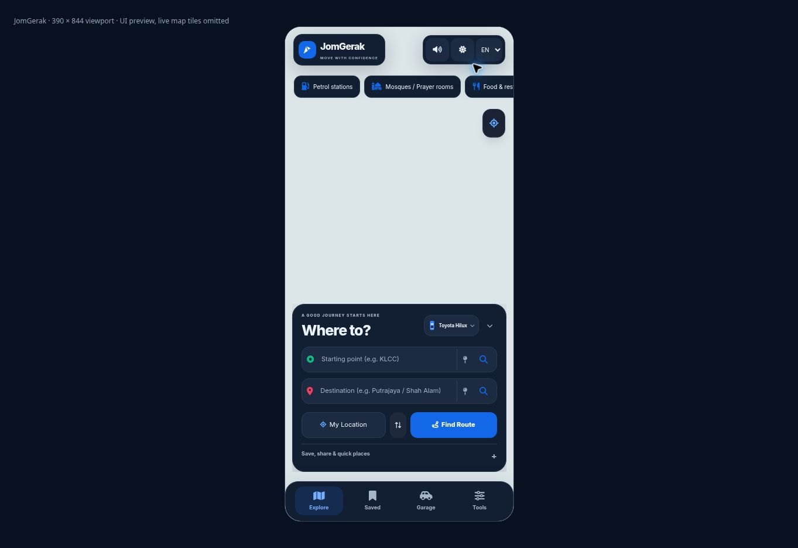
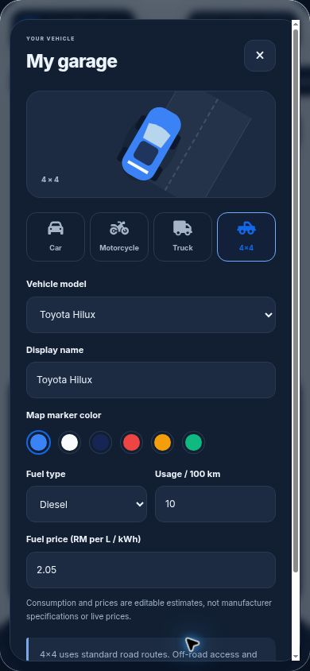

# Premium navigation shell, English coverage and Garage

This change is based on merged main `9978e8e84849a072d14d1abbdbd5b3a6824b5766`. It keeps the Leaflet/OSM map, route handlers, saved places, history, report backend and existing travel tools. Pintaz's public website and web map were inspected as visual references; this is an original JomGerak interface, not a copy of its native app or a claim of feature parity.

## User-visible changes

- Navy/blue map-first interface with a consistent wordmark, clearer search fields and a persistent Explore / Saved / Garage / Tools navigation bar.
- Phone search panel sits above the bottom navigation; tools open in a separate scrolling sheet. The sheet can be closed from its close button, backdrop, Escape or bottom navigation.
- The two tiny floating diagnostic launchers are removed. Diagnostics remain available under Tools → Settings → Diagnostics.
- English is the initial language for new sessions; a previously saved language preference is retained. The initial HTML is English, so it does not flash Malay while scripts load. The central catalogue currently contains 427 mappings and handles late-created controls, notification templates, tooltips, placeholders and accessibility labels. BM/EN switching remains available.
- Name/address fields, place names, custom vehicle names and user-authored report notes are excluded from UI translation. Stored backend report-type identifiers stay unchanged.
- Garage offers car, motorcycle, truck and 4×4 categories, common model names or a custom name, six marker colors and editable consumption/fuel-price estimates. Model names select a vehicle profile; these are category illustrations, not licensed or model-specific 3D meshes.
- The selected profile persists locally, updates the GPS map marker and drives the existing trip-cost calculation. The older vehicle-profile action now opens Garage so there is a single source for cost preferences.
- Truck dimensions can be saved. Truck route calculation/navigation is explicitly blocked: the current engine cannot verify truck height, gross weight or access restrictions. Motorcycle and 4×4 retain clearly labelled standard-road routing limits. No off-road capability is implied.
- A report button previously submitted `Polis`, which the existing backend does not accept. It now submits the supported `Jalan Ditutup` road-closure category. Other report options continue to work as before.

## Validation

`node --test tests/audit.test.cjs`: **31 passing tests**. Includes the previous navigation race/route tests plus locale templates, translation convergence and user-content protection, profile validation/persistence, cost synchronization, vehicle-mode synchronization, truck guards, vehicle changes before map startup, cached assets and all offered report categories matching backend types. All browser/server JavaScript parses and `git diff --check` passes.

Browser UI checks performed through the cloud browser:

- Desktop viewport and actual iframe CSS viewports at **390×844** and **320×640**. At 320px, document `clientWidth` and `scrollWidth` were both 320px.
- English main screen, Map/Journey/Settings tabs, no-voice message, road-report dialog, Garage category/model controls, save/close and saved profile display.
- Floating diagnostic launchers absent; diagnostics accessible through the tool menu.

The browser received an OSM tile usage/access-block image on the original map. Local UI QA therefore **omitted live tile requests** rather than bypassing the block. The tracked production `index.html` still initializes the normal configured map; the preview-only harness and tile omission are not committed. These screenshots verify interface layout only. They do not verify GPS, live map/service availability, voice output, device keyboards or production navigation.

## Follow-up validation

After reviewing the PR preview, test on real Android and iPhone: search, Nearby pins, route selection, keyboard opening/closing, GPS marker appearance, driving HUD, background/resume, dark/light themes, and English across actual service success/error responses. The earlier production API capacity, offline routing and truck/motorcycle-specific routing limitations still apply. Google/Apple authentication and native store packaging are separate pending work; this change does not add mock sign-in buttons or certify release readiness.
